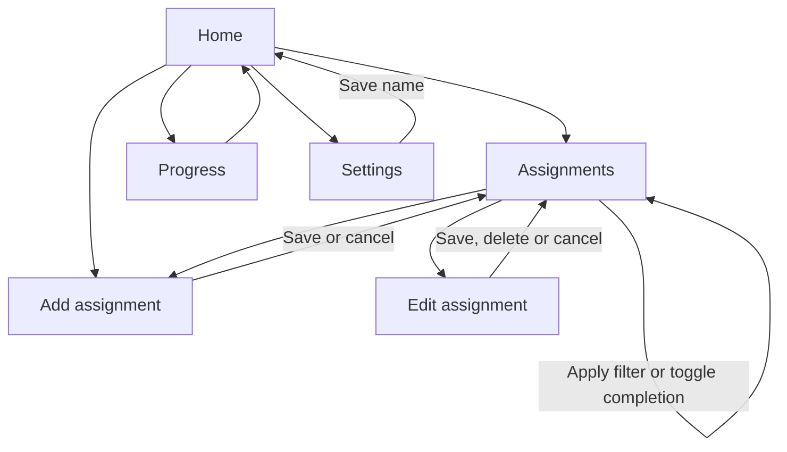

Final Project Design Phase
Computer Science - Week 11
Oct 3, 2026 - Version 0.0.4

For complete instructions and project ideas, refer to the assignment in Canvas. Specifically, review the final project requirements before you continue below. If you have not reviewed the project requirements in Canvas (you might have to go to the modules view and check the current or past week's content), you will not be able to properly complete the parts below. In addition, it may be helpful to review the information on this Drafter documentation page.
0) Project Planning and Preparation
Successful programmers spend time planning before they begin coding. After reviewing the project requirements, answer the following questions to help guide your design and development process. 
What concepts from class or previous assignments might help you complete this project? Which programming concepts (loops, conditionals, lists, classes, etc.) do you expect to use? What programming skills do you want to improve while completing this project?
The Tech Debt assignment will help me because it used Student objects with lists of Course objects. My tracker will use State with a list of Assignment objects. I will use loops, conditionals, dataclasses, lists, functions, and Drafter inputs and buttons. I want to improve at updating objects and passing data between routes.

Which parts of the project do you expect to be the easiest for you? The hardest? Why?
Creating the dataclasses and basic pages will probably be easiest because I have practiced them before. Editing the correct assignment and keeping the filters and progress totals updated will be hardest because those features depend on the same stored data.

Even though you have not yet designed the final project, estimate which tasks will likely require the most time and effort? Which features or components should be implemented first? 
Connecting the routes and editing assignments will take the most effort. I estimate one hour for the dataclasses and pages, two to three hours for the features, and one to two hours for testing. I will build State and Assignment first, then add and view assignments. After that I will add editing, completion, filtering, progress, and settings.

What distractions might interfere with your work and how will you minimize them? What resources will you need available while working? What questions, if any, do you still have about the assignment requirements? 
My phone and work for other classes could distract me. I will put my phone away and work in blocks with one feature to finish each time. I will need the project requirements, Drafter documentation, previous assignments, and assert_equal for testing. I have no questions right now, but I will ask my TA if I get stuck.

1) Site Diagram
Create a mock-up of your planned website. We suggest you make the mockup on paper, although you can also use software like PowerPoint or Slides to make a mockup. There is other design software that could also be used, but we strongly encourage you to keep it simple. Do not spend more than 15-30 minutes detailing the mock-up. Your goal should be to make a very quick and dirty diagram, to show that you have some kind of idea.

We recommend drawing each page as a rectangle, and laying out the text, buttons, and other components inside. Then, use arrows to indicate links between pages. Label each page the way you will name each function, and then put labels on the arrows to indicate what the button links. Also write down any parameters that should come into the pages.

In addition to the pages and routes, write down what fields your `State` will have, both their names and types. Think clearly about what data will need to be persistent across the entire website.

Add photo(s) or screenshot(s) of your website mock-up and labeled diagram on the next page. 
State: assignments: list[Assignment]; student_name: str; status_filter: str; next_id: int.
All routes receive state. Assignment-specific routes also receive assignment_id.

 2) Implementing Requirements
This table should serve as a draft for how you will implement the requirements into your final project. You may change your ideas later on, but your final site must fulfill all the requirements.

Requirement
Implementation
Purpose/Functionality

A 1-2 sentence description of the purpose or functionality of your site
My site will help students track their assignments in one place. Users can add and edit assignments, mark them complete, filter the list, and view their progress.
State Dataclass Attributes
 
Minimum of 4 attributes, one of which must be a list/dict of instances of your second dataclass.

Briefly describe each attribute, its type, and how it will be meaningfully modified throughout the site.
assignments: list[Assignment] — stores assignments; routes add, edit, delete, complete, or reopen them.
student_name: str — changes when the user saves their name in Settings.
status_filter: str — changes when the user selects All, Pending, or Completed and applies the filter.
next_id: int — increases whenever a valid assignment is added, giving each assignment a unique ID. All four fields change through routes.

Second Dataclass

Your second dataclass, including its attributes, their types, and how they will be meaningfully modified (if they are modified)
Assignment:
assignment_id: int — unique ID set when created; stays unchanged.
title: str, course: str, due_date: str, priority: str, notes: str — entered when adding and changed when editing. Dates use YYYY-MM-DD text.
completed: bool — starts False; changes when the user completes or reopens the assignment.

Routes (minimum 7) 

The names of your route functions
index, assignment_list, add_assignment, save_assignment, edit_assignment, update_assignment, toggle_complete, delete_assignment, set_filter, progress, settings, save_settings.
All receive state. edit_assignment, toggle_complete, and delete_assignment also receive assignment_id. update_assignment receives assignment_id and the edited fields. save_assignment receives title, course, due_date, priority, and notes. set_filter receives status_filter; save_settings receives student_name.

Pages (minimum 5)

A brief description of the pages in your site
Home: welcome message and navigation.
Assignments: filtered assignment list with Edit and Complete/Reopen buttons.
Add Assignment: form with Save and Cancel.
Edit Assignment: current values with Save Changes, Delete, and Cancel.
Progress: total, completed, pending, and completion percentage.
Settings: name input and Save Name.

User Input (minimum 3)

Description of user input components (TextBox, TextArea, CheckBox, or SelectBox) and their purposes

For more information on these input types, see Drafter Documentation.
TextBox: title — assignment name.
TextBox: course — class name.
TextBox: due_date — deadline.
SelectBox: priority — Low, Medium, or High.
TextArea: notes — extra instructions.
SelectBox: status_filter — All, Pending, or Completed.
TextBox: student_name — personalizes Home.

If Statements (minimum 3)
Brief description of what will be evaluated in your if statements and how they will meaningfully change the logic of the site
If title or course is blank, show an error instead of saving.
If completed is True, show Completed and Reopen; otherwise show Pending and Complete.
If status_filter is Pending or Completed, display only matching assignments; All displays everything.
If there are no assignments, show an empty-list message and 0% progress instead of dividing by zero.

Loop (minimum 1)
This loop must iterate over the list/dict of dataclass instances in your State attribute.
Description of this loop and why it is meaningful to the site
I will loop through state.assignments and read each Assignment object's fields to display assignments matching the filter. Another loop will count completed assignments to calculate progress. The results will update when assignments are added, edited, completed, or deleted.

## Page map

